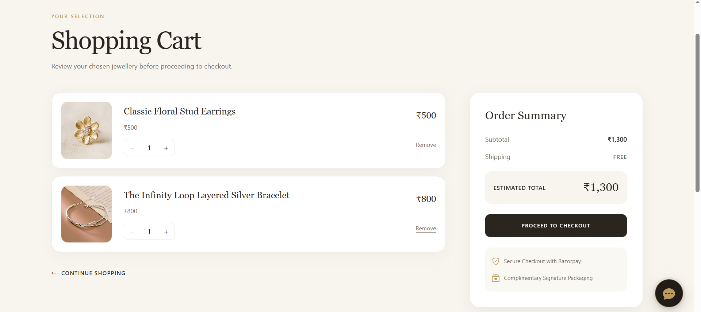
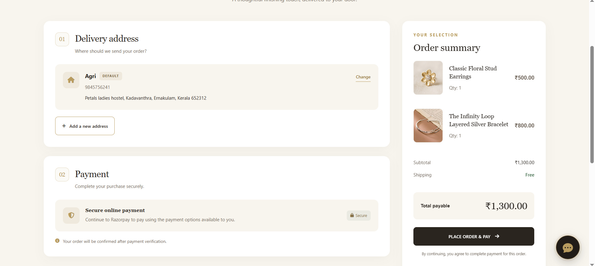
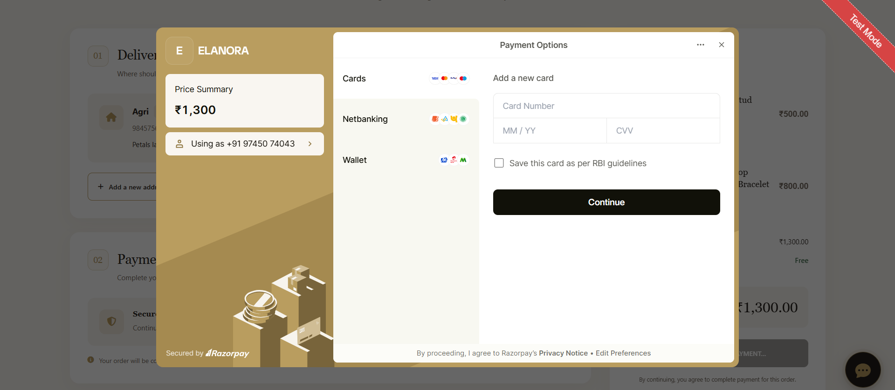

# ELANORA – Jewellery E-commerce Platform

A full-stack jewellery e-commerce web application built using **Python, Django, and Django REST Framework**, designed to provide a seamless online shopping experience.

ELANORA brings together product discovery, secure authentication, shopping cart management, online payments, order processing, and an AI-powered shopping assistant in one platform.

The application is deployed on AWS EC2 using Gunicorn and Nginx, with PostgreSQL for database management and HTTPS for secure access.
## ✨ Key Features

- **User Authentication:** Secure registration, login, and JWT-based authentication.
- **Product Catalogue:** Browse jewellery products with categories, variants, search, and filtering.
- **Shopping Cart:** Add, update, and remove products from the cart.
- **Order Management:** Place orders, view order history, track order status, and manage cancellations.
- **Payment Integration:** Razorpay payment integration with payment verification.
- **Inventory Management:** Manage product stock and inventory during order processing.
- **AI Shopping Assistant:** Google Gemini-powered assistant to help customers discover products.
- **Responsive Design:** User-friendly shopping experience across desktop and mobile devices.

---

## 🛠️ Tech Stack

| Category | Technologies |
|---|---|
| Backend | Python, Django, Django REST Framework |
| Frontend | HTML5, CSS3, JavaScript, Bootstrap 5 |
| Database | PostgreSQL, SQLite |
| Authentication | JWT, Django Authentication |
| Payment Gateway | Razorpay |
| AI Integration | Google Gemini API |
| Deployment | AWS EC2, Linux, Gunicorn, Nginx |
| API Testing | Postman |

## 🏗️ Application Architecture

The application follows Django's MVT architecture, with Django REST Framework providing RESTful API endpoints for application functionality.

- **Frontend:** Responsive user interface built with HTML, CSS, Bootstrap, and JavaScript.
- **Backend:** Django handles business logic, authentication, product management, cart, orders, and payments.
- **API Layer:** Django REST Framework provides API endpoints.
- **Database:** PostgreSQL stores application data.
- **External Services:** Razorpay handles payment processing, while Google Gemini powers the AI shopping assistant.

- ---

## ⚙️ Installation & Setup

Follow these steps to run ELANORA locally.

### 1. Clone the repository

```bash
git clone https://github.com/AgrimaPT/elanora-ornament-store.git
cd elanora-ornament-store
```

### 2. Create and activate a virtual environment

**Windows:**

```bash
python -m venv venv
venv\Scripts\activate
```

**Linux / macOS:**

```bash
python3 -m venv venv
source venv/bin/activate
```

### 3. Install dependencies

```bash
pip install -r requirements.txt
```

### 4. Configure environment variables

Create a `.env` file in the project root and configure the required settings.

Example variables (use your own credentials):

```env
SECRET_KEY=your_django_secret_key
DEBUG=True
DATABASE_URL=your_database_url
RAZORPAY_KEY_ID=your_razorpay_key
RAZORPAY_KEY_SECRET=your_razorpay_secret
GEMINI_API_KEY=your_gemini_api_key
```

### 5. Apply database migrations

```bash
python manage.py migrate
```

### 6. Create a superuser

```bash
python manage.py createsuperuser
```

### 7. Run the development server

```bash
python manage.py runserver
```

Open your browser and visit:

```text
http://127.0.0.1:8000/
```

**Note:** Configure all required environment variables and database settings before running the application. Never commit real API keys, passwords, or secret credentials.


---

## 🚀 Deployment

ELANORA is deployed on **AWS EC2**.

The production environment uses:

- **AWS EC2** – Application hosting
- **Gunicorn** – WSGI application server
- **Nginx** – Reverse proxy and web server
- **PostgreSQL** – Production database
- **SSL/HTTPS** – Secure communication

## 🧪 Testing

The application includes automated tests for important application workflows, including payment and order-related functionality.

API endpoints were also tested using Postman.

## 🔐 Security

- Environment variables are used to manage sensitive configuration.
- JWT-based authentication protects authenticated API operations.
- Razorpay payment verification is handled on the backend.
- HTTPS is enabled in the production deployment.

## 👩‍💻 Author

**Agrima P T**

Python / Django Developer

- GitHub: [AgrimaPT](https://github.com/AgrimaPT)
- LinkedIn: [Agrima P T](https://www.linkedin.com/in/contactagrima/)

## Application Screenshots

### Home Page


### Home Page – Categories


### Shop Page


### Product Details


### Shopping Cart


### Checkout


### Payment


